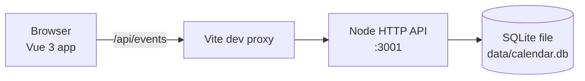

[](https://github.com/isidore/NitsanExperiment/actions/workflows/ci.yml)

# 📅 Shared Calendar

A shared calendar for a group: anyone in the group can add events, and everyone sees the same week.
Each event block is colored by **who made it**, and attendee avatars show **who's going**.
It's self-contained (it does not sync to personal calendars).

Built live in a Learning Hour with [Claude Code](https://claude.com/claude-code).

## Features

- 🗓️ Week view grid shared by the whole group
- ➕ Anyone in the group can add events
- 🎨 Event blocks colored by the person who created them, with a members legend
- 👥 Attendees shown as avatars in the grid and as name chips in the feed
- 💾 Events persisted on the server in a SQLite database

## Tech stack

- **TypeScript** everywhere
- **Vue 3** + **Vite** for the front end
- **Vitest** (+ Vue Test Utils, jsdom) for tests
- **Node `http`** API server (run directly with Node's native TypeScript type-stripping)
- **SQLite** via Node's built-in `node:sqlite`

## Getting started

Requires **Node 24+** (for `node:sqlite` and native TypeScript support).

```sh
npm install
npm run dev     # web app on http://localhost:5173, API on http://localhost:3001
npm test        # run all tests once
```

The Vite dev server proxies `/api` to the API on port 3001. The API stores data in `data/calendar.db`
(override with the `DB` env var; the port with `PORT`).

## Project structure

```
.
├── src/             # Vue app (App.vue, components/, calendar + color logic, event store client)
│   └── __tests__/   # front-end unit/component tests
├── server/          # Node HTTP API + SQLite event store
│   └── __tests__/   # API and store tests
├── mockup/          # static HTML mockup of the first happy-path story
└── data/            # SQLite database file (git-ignored, created at runtime)
```

## Architecture



## Scripts

| Script               | What it does                                         |
| -------------------- | ---------------------------------------------------- |
| `npm run dev`        | Runs the API (with `--watch`) and the Vite dev server |
| `npm run dev:web`    | Vite dev server only, on port 5173                   |
| `npm run dev:api`    | API server only, with `--watch`                      |
| `npm run api`        | API server only                                      |
| `npm test`           | Runs all tests once (`vitest run`)                   |
| `npm run test:unit`  | Runs Vitest in watch mode                            |
| `npm run type-check` | Type-checks with `vue-tsc --build`                   |
| `npm run build`      | Type-check + production build into `dist/`           |
| `npm run build-only` | Production build without type-checking               |
| `npm run preview`    | Serves the production build locally                  |
