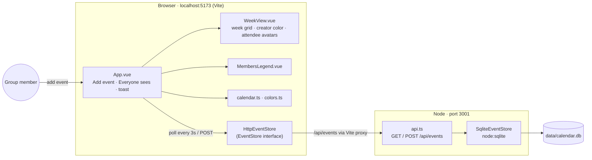
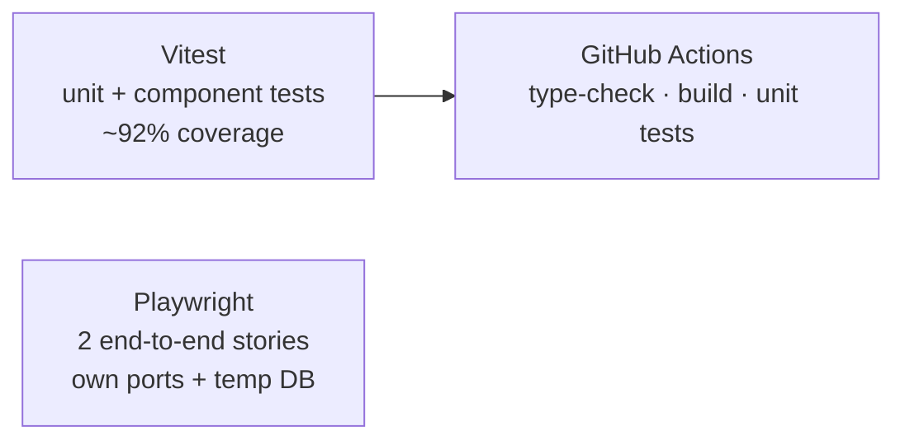

# Architecture

A shared group calendar: every browser reads and writes the same SQLite file through a small Node API, so other tabs see new events within ~3 seconds.

## Pieces

| Part | File(s) | Role |
|---|---|---|
| Model | `src/calendar.ts` | `CalendarEvent` (title, start, addedBy, attendees), `SharedCalendar`, `weekOf()` |
| Colors | `src/colors.ts` | `colorFor(name)`: fixed colors for known people, distinct fallback palette for others |
| Storage seam | `src/eventStore.ts` | `EventStore` interface with in-memory (tests) and HTTP (browser) implementations |
| UI | `src/App.vue`, `src/components/*` | Week view (default), list view, add form, "Everyone sees" feed, members legend |
| API | `server/api.ts` | `node:http` server: `GET/POST /api/events`, validates input |
| Persistence | `server/sqliteEventStore.ts` | SQLite via Node's built-in `node:sqlite`; migrates the `attendees` column in place |

## Design decisions

- **Block color = who made the event; avatars = who's going.** Chosen by team vote between mockup options.
- **Swappable storage.** Everything goes through `EventStore`, so moving to a hosted DB (e.g. Supabase) is one new class.
- **Polling, not push.** The browser refreshes every 3 s. Server-sent events would be the next step for instant updates.
- **Self-contained.** No sync to personal calendars and no login (yet).

## Safety net

- `npm test`: unit tests · `npm run coverage`: HTML coverage report · `npm run e2e`: end-to-end tests (local only)
